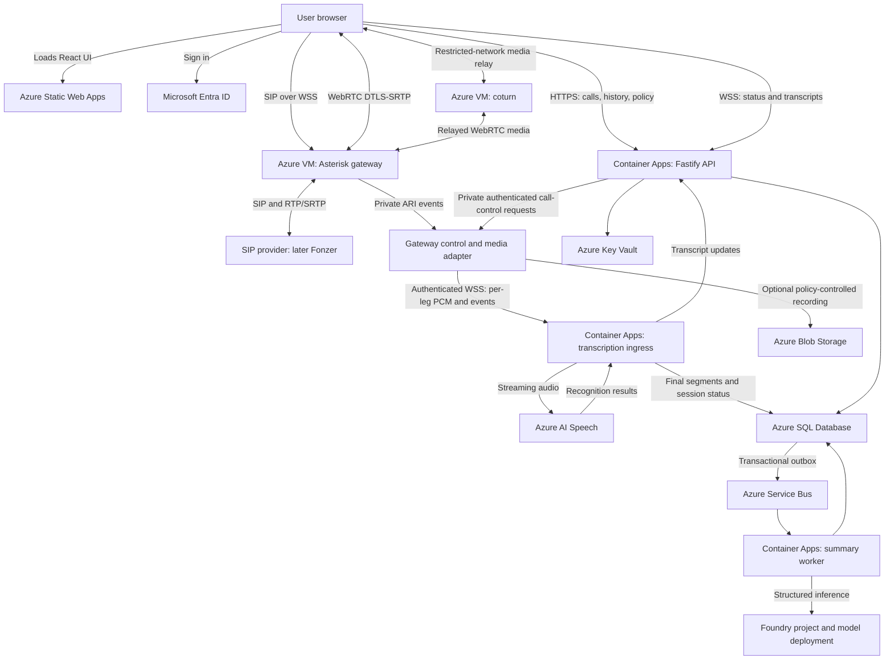

# PhoneBuddy: software and delivery plan

Planning baseline: 29 October 2026. This document contains proposed decisions and acceptance criteria, not claims of deployed or tested functionality.

## 1. Outcome and scope

Build a web-based softphone that makes and receives calls through SIP, automatically transcribes both sides in Dutch and English, and produces useful summaries and action items. Operate the application, media gateway, data services, and model inference on Azure. Define Azure infrastructure in Bicep. Begin with a working agentic software factory so subsequent features arrive with specifications, tests, deployment evidence, and traceability.

Confirmed rollout: an internal pilot, architecturally ready for multiple organizations. Initial language support: Dutch and English, including representative Flemish accents and calls that switch language. Start with one-to-one calls and one active call per user; conference calls and attended transfers follow later.

Pilot features:

- Entra sign-in, audio-device selection, dial pad, inbound ringing, accept/reject, mute, hold/resume, DTMF, and hangup.
- Call history and detail view, connection/transcription status, live transcript, final transcript, and summary.
- Summary with decisions, open questions, action items, and links to supporting transcript segments.
- Organization administration for users, SIP provider configuration, transcription policy, retention, and quotas.
- Explicit notice and controls for transcription; optional recording under a separately configured policy.

Defer CRM actions, autonomous follow-up messages, cross-call semantic search, mobile background calling, conferencing, and public self-service onboarding. Browser calls require an active supported browser session; do not promise ringing after the tab/browser closes.

## 2. Changes to the reference architecture

Keep Vite + React on Azure Static Web Apps, a Fastify application layer on Azure Container Apps, Azure Speech for recognition, and models deployed in Azure AI Foundry, now documented as Microsoft Foundry.

Add the missing telephony/media layer. SIP signaling and call audio are different paths: browsers use SIP over secure WebSocket plus WebRTC media; a gateway bridges these to the provider's SIP and RTP/SRTP requirements. Fastify is the application API and transcription ingress, rather than a SIP/media server. [SIP.js transport documentation](https://sipjs.com/guides/user-agent/), [Asterisk WebRTC configuration](https://docs.asterisk.org/Configuration/WebRTC/Configuring-Asterisk-for-WebRTC-Clients/).

Use Azure VMs for the SIP/WebRTC gateway and TURN relay. Container Apps ingress supports HTTP and TCP, including WebSocket support, but does not provide a general UDP ingress solution for the planned RTP media path. This hosting split is an architectural recommendation based on those protocol requirements. [Container Apps ingress](https://learn.microsoft.com/en-us/azure/container-apps/ingress-overview).

Do not adopt ACS Direct Routing as the foundation for this new standalone SIP client. Microsoft's current guide lists Direct Routing for retirement on 30 September 2028 and blocks new customers from retiring services beginning 23 October 2026. Supported future ACS calling scenarios are tied to eligible Teams integrations; that does not establish a general standalone SIP replacement. [ACS lifecycle guide](https://learn.microsoft.com/en-us/azure/communication-services/acs-retirement-and-breaking-changes-guide).

Replace the assumed Foundry Hub with the current Foundry resource/project approach unless a specific feature requires a hub. Microsoft provides a Bicep deployment path for a Foundry resource and project. [Foundry Bicep quickstart](https://learn.microsoft.com/azure/foundry/how-to/create-resource-template).

Scale asynchronous work to zero where appropriate. Keep the pilot gateway running continuously; initially keep one transcription-ingress replica and one API replica warm during service hours. Revisit these minimums after measuring startup and reconnect behavior. Scale-to-zero is not a suitable default for incoming-call availability.

## 3. Proposed architecture



The outbox arrow represents an application dispatcher reading committed outbox rows and publishing them; Azure SQL does not publish these messages by itself. The API-to-ingress update path starts as a single-replica pilot notification path. Before multiple API replicas, add Azure Web PubSub for shared browser fan-out, or an equivalent explicitly implemented backplane.

Static Web Apps hosts assets only. Connect browser WebSockets directly to authenticated application/gateway endpoints, not through the SWA `/api` proxy: SWA API integrations do not support WebSockets. Authorize the API independently of frontend route protections. [SWA API constraints](https://learn.microsoft.com/en-us/azure/static-web-apps/apis-overview/).

### Component decisions

| Concern | Pilot choice | Evolution path |
| --- | --- | --- |
| Browser | React + Vite + TypeScript; SIP.js behind a telephony interface | Full SIP.js API where advanced controls are needed |
| Application | Fastify + TypeScript; REST/OpenAPI and versioned WebSocket messages | Keep domain logic independent of hosting |
| SIP and media | Asterisk on a supported, pinned release with required WebRTC/media modules | Add SIP edge/SBC specialization when load or provider requirements justify it |
| NAT traversal | coturn on Azure VM; short-lived relay credentials | Separate relay nodes, capacity limits, and redundancy before production |
| Streaming STT | Separate Container App using the Azure Speech SDK | Prove Node SDK identity/streaming support; use a small .NET adapter if required |
| Summary | TypeScript worker; schema-constrained inference against Foundry deployment | Add richer workflows only after evaluation evidence |
| Metadata | Azure SQL Database | Organization-aware access and optional dedicated databases later |
| Large artifacts | Private Blob Storage | Organization-specific containers/accounts if isolation requires them |
| Async work | Service Bus Standard with dead-letter queues | Premium if measured capacity or private connectivity requires it |
| Secrets/identity | Managed identities and Key Vault | Separate identities per service and environment |
| Operations | Application Insights, Log Analytics, Azure Monitor; OpenTelemetry | Correlated service and call diagnostics |

SIP.js SimpleUser has explicit limitations, including no transfer support. Use it only if it fits the pilot; maintain the interface boundary so moving to the full API does not rewrite the UI. [SIP.js feature limitations](https://sipjs.com/guides/simple-user/).

### Gateway and Fonzer integration

Start against a controlled SIP test system. Add provider profiles rather than embedding Fonzer-specific behavior into the dialer, transcript pipeline, or call domain.

There are two distinct future Fonzer arrangements: registering as an extension of a hosted Fonzer PBX, or connecting our gateway to a Fonzer SIP trunk. Confirm which product/account the pilot will use. Fonzer publicly documents SIP accounts for its softphone and offers SIP trunks, but those facts do not confirm that this customer's account permits a third-party gateway, exposes WebRTC, or supports a particular authentication/security configuration. [Fonzer softphone documentation](https://fonzer.zohodesk.eu/portal/en/kb/articles/fonzie-user-s-manual), [Fonzer SIP trunks](https://fonzer.com/en/trunks).

Provider discovery checklist for the first spike:

- Extension versus trunk; registration credentials versus IP allowlisting; simultaneous registration rules.
- SIP transport, registrar/proxy, inbound routing, outbound identity, codecs, encryption, and DTMF mode.
- Allowed call destinations, channel limits, transfer behavior, backup routes, and event/CDR APIs.
- Permission to anchor media and transcribe/record it; treatment of existing PBX queues and extensions.
- Emergency-call routing requirements and a clear pilot policy agreed with the telephony owner before real PSTN use.

A REST click-to-call API is not a substitute for a bidirectional browser audio path. Keep trunk credentials on the gateway. Give the browser only its own narrowly scoped gateway credential; never expose provider-wide credentials. Temporary SIP credential provisioning, expiry, and revocation are application features to implement and prove, not assumed native token support.

For the pilot, one gateway VM and coturn may share a host. Separate them for production. Use fixed public addresses, provider allowlists where possible, bounded media port ranges, valid TLS certificates, registration/rate limits, and restricted dial plans. Keep ARI and management interfaces private. Disable direct-media bypass for calls that need a server media tap.

## 4. Call and transcription lifecycle

1. Entra authenticates the user. The backend derives organization membership and policy from trusted identity and membership records.
2. The API creates a call session and authorizes the user, destination, concurrency, and transcription policy. Incoming SIP events create the same internal session structure before the UI receives ringing status.
3. The gateway associates SIP dialogs and media legs with the internal call ID. Browser-provided call IDs alone never authorize access or determine organization ownership.
4. The browser and gateway establish WebRTC; the gateway connects the provider leg. Voice transport remains independent of AI services.
5. When policy permits, the gateway adapter forks each direction into a separate read-only capture path. Preserve a shared call clock, leg ID, sequence number, timestamp, codec metadata, and explicit gap markers.
6. The adapter decodes/resamples audio to the Speech-supported PCM format and streams it to transcription ingress. Do not treat arbitrary MediaRecorder/WebM/Opus chunks as PCM. Silence and reconnect events must preserve call timing.
7. Ingress runs one recognizer per leg for the initial two-party design, persists final segments, and publishes interim/final updates. Per-leg attribution provides a known local/remote role; it does not prove the identity of an unknown remote person.
8. At hangup, finalize each recognition stream with a bounded timeout. A call-completion coordinator seals a transcript revision once both legs close or are marked incomplete. Persist the revision and summary-request outbox record in the same database transaction.
9. The summary worker processes the sealed revision. Retried deliveries use a unique key containing organization, call, transcript revision, and summary configuration version. Late transcript corrections create a new revision and a superseding summary.
10. The UI shows completion, gaps, failures, and summary provenance. A missing transcript yields an explicit unavailable/partial result, never an invented summary.

The media spike must prove per-leg capture without echo or duplicated audio. Asterisk's current `chan_websocket` supports media exchange over WebSockets, including TLS, and is available in specific release lines; pin and test a compatible supported release. Its existence does not prove our proposed snoop/per-leg topology. If that topology fails, validate a local RTP/AudioSocket adapter on the VM and bridge to ACA over WSS. Do not expose UDP audio to ACA. [Asterisk media WebSocket documentation](https://docs.asterisk.org/Configuration/Channel-Drivers/WebSocket/).

Use diarization for future mixed/conference streams rather than as the primary two-party identity mechanism. Speech diarization returns generic speaker labels, not verified identities. Test Dutch/English recognition, language switching, names, accents, noise, and narrowband phone audio on representative examples. Select per-call language as the reliable baseline; evaluate automatic language identification before enabling it by default. [Speech diarization quickstart](https://learn.microsoft.com/azure/ai-services/speech-service/get-started-stt-diarization).

### Failure and deployment behavior

- Speech/Foundry failure must not terminate the call. Forked media processing has bounded buffers and no backpressure into the voice bridge.
- On overload, reject new transcription sessions explicitly or mark gaps; do not silently truncate or buffer without limits.
- Use short-lived authenticated stream setup, origin checks, per-call permissions, connection limits, and service identity. A bare WebSocket call ID is insufficient.
- Prove 30–60 minute streaming sessions, token refresh, reconnect, silence, and every proxy hop. ACA WebSocket support does not establish end-to-end session continuity.
- Use active-session-aware admission, capacity limits, and controlled replica changes. A warm minimum alone does not prevent scale-in or revision replacement from disconnecting streams. Start with fixed ingress capacity; automate scale-out after load tests and retain/reconnect affected streams deliberately.
- Transcription process replacement may cause a visible gap. Recording-based recovery is available only when recording was enabled, and must deduplicate recovered segments.
- Gateway maintenance drains new calls before replacing a node. A second gateway improves availability for new calls; it does not transparently preserve an established call on a failed node.

Speech identity integration is an explicit spike: test the chosen SDK's custom endpoint, Entra token configuration, refresh, and private-network behavior. Prefer managed identity; do not silently fall back to hardcoded service keys. [Speech Entra authentication](https://learn.microsoft.com/en-us/azure/ai-services/speech-service/how-to-configure-azure-ad-auth).

## 5. Summary and AI design

Use a bounded workflow for summarization: read an authorized immutable transcript revision, call a Foundry model with structured output, validate it, and persist it. The model receives no telephony controls, unrestricted tools, or ability to message people. Agentic development belongs in the software factory; reliable call summarization does not require an open-ended multi-agent runtime.

Version prompt, output schema, model name/version, deployment type, language policy, and evaluation dataset together. Use deployment aliases such as `call-summary` so the application does not hardcode a model SKU. Benchmark currently available smaller models against a stronger reference model in the permitted Azure geography. The reference's `gpt-4o-mini` is a candidate only after verifying availability, lifecycle, quota, and evaluation results at implementation time.

Proposed structured result:

```json
{
  "schemaVersion": "1",
  "transcriptRevision": 3,
  "language": "nl",
  "title": "...",
  "summary": [{ "text": "...", "segmentIds": ["seg-12"] }],
  "decisions": [{ "text": "...", "segmentIds": ["seg-18"] }],
  "actionItems": [{
    "text": "...",
    "owner": null,
    "dueDate": null,
    "segmentIds": ["seg-21"]
  }],
  "openQuestions": [],
  "qualityFlags": ["partial-transcript"]
}
```

Every material claim requires source segments. Validate segment ownership and existence in code; evaluate whether the cited text actually supports the claim. Missing owners/deadlines remain null. Treat transcript instructions as untrusted conversation content. For long calls, use chunked extraction and evidence-preserving reduction rather than uncontrolled truncation. Generated action items remain suggestions until a user acts on them.

Use an allowed geography or approved EU data-zone deployment when required. An EU-located Foundry resource alone does not ensure EU inference: Global deployment types can process elsewhere. Confirm the actual data-zone boundary against the organization's policy; it is not necessarily restricted to EU member states. No automatic fallback to a different geography. [Foundry deployment processing locations](https://learn.microsoft.com/en-us/azure/ai-foundry/model-inference/concepts/deployment-types).

## 6. Organization boundaries and data handling

Use an application-level `organizationId` distinct from an Entra directory ID. One directory may contain several organizations, and future organizations may admit guests or identities from different directories.

Initial entities: Organization, OrganizationMembership, User, ProviderConnection, SipEndpoint, Call, CallLeg, TranscriptSession, TranscriptSegment, TranscriptRevision, Summary, RecordingArtifact, PolicyDecision, OutboxEvent, ProcessingAttempt, and AuditEvent.

All business entities, object references, queue messages, and idempotency keys include organization scope. Determine scope from authenticated membership and server-side call ownership. Use composite organization/entity foreign keys and SQL row-level security as defense in depth; explicitly set/reset database session context when pooling connections. Test cross-organization access through list, detail, search, export, WebSocket subscription, job replay, and blob access.

Pilot storage is shared with enforced logical isolation. Prepare a routing abstraction for dedicated storage/databases or deployments where future customers need stronger isolation. Shared gateway processes are also a trust boundary: map extensions, credentials, routing contexts, quotas, and call ownership to organizations; add dedicated gateways if the threat model requires them. Architectural readiness does not mean certification for public multitenant SaaS.

Store final transcript content and summaries in SQL; keep optional audio and large exports in Blob Storage. Preserve original ASR segments and represent user corrections as versioned edits. Avoid persistent interim transcripts. Browser reads of audio require an authorized backend operation or short-lived object-specific URL; organization prefixes alone are not access control.

Recording and transcription are separate policies. Default persistent recording off; configure transcript, summary, telemetry, and backup retention explicitly before the pilot. Temporary media buffers still need bounded lifetime and deletion behavior. The organization must define its lawful basis, notice, access, and retention obligations before real calls; do not present a technical toggle as a compliance determination.

Implement deletion across SQL, blobs, derived summaries, exports, queued work, and caches. Tombstones prevent delayed jobs from recreating deleted content. Document backup expiry and restore procedures that reapply deletion records. Audit access and changes without copying full phone numbers, audio, or transcript content into logs. Keep production call data out of software-factory sandboxes and evaluation fixtures; use synthetic or explicitly approved de-identified examples.

## 7. Bicep infrastructure and environments

Use a monorepo with shared contracts and separate deployable services. Proposed layout:

```text
apps/web/
services/api/
services/transcription/
services/summary-worker/
services/gateway-adapter/
packages/contracts/
packages/domain/
packages/telephony/
ai/prompts/
ai/schemas/
ai/evals/
factory/agents/
factory/prompts/
factory/policies/
factory/workflows/
infra/main.bicep
infra/modules/
infra/environments/{dev,test,prod}.bicepparam
infra/bootstrap/
gateway/config/
gateway/image/
pipelines/
tests/{unit,contract,integration,e2e,telephony}/
docs/{adr,runbooks,specs}/
AGENTS.md
```

`AGENTS.md` will define project conventions, build/test commands, architecture boundaries, expected evidence, and agent permissions. It is a planned factory deliverable, not yet an implemented control.

| Bicep module | Resources / configuration |
| --- | --- |
| Foundation | Resource groups, naming/tags, budgets, policy assignments, identities/RBAC |
| Network | VNet/subnets, NSGs, fixed public IPs, DNS zones, selected private endpoints/DNS |
| Observability | Log Analytics, Application Insights, dashboards, alerts, action groups |
| App platform | Container Apps environment, Container Registry, service apps/jobs, scaling/probes |
| Frontend | Static Web App and custom-domain resources where supported |
| Data | Azure SQL server/database, storage/container policy, Key Vault |
| Messaging | Service Bus namespace/queues, retry/dead-letter configuration |
| AI | Foundry account/project, model deployments, Speech resource, required role assignments |
| Telephony | Gateway/relay VM resources, disks, network rules, image references, managed identities |
| Factory | Separate factory resources, model deployments, work queues, ephemeral sandbox VM template |

Prefer maintained Azure Verified Modules where appropriate and pin versions. Pin ARM API versions, container/image digests, dependency lockfiles, and environment parameters. Use stable APIs when they support required features; document any preview dependencies and exit plan.

Use dev/test/prod boundaries, separate production subscriptions where practical, and a separate factory resource group/subscription boundary. Select EU regions through an availability/quota matrix for Speech, chosen Foundry models/deployment types, ACA, SQL, and networking; do not assume all dependencies are available in a single region. Choose a compatible same-geography layout after the spike.

Azure resource creation and configuration belong in Bicep. VM operating-system packages, Asterisk/coturn configuration, application releases, SQL migrations, and agent/prompt definitions are versioned software artifacts deployed through pipelines. Build a reproducible gateway image with Azure VM Image Builder, whose Azure resources are provisioned in Bicep; do not rely on manual SSH changes.

There are unavoidable non-ARM boundaries: an Azure DevOps organization/project and policies, Entra application consent, externally owned DNS/domain validation, and a Fonzer account cannot all be honestly represented as ordinary Azure Bicep resources. Record prerequisites and use supported declarative extensions where mature, otherwise small idempotent bootstrap/API scripts with a drift report. Keep these in `infra/bootstrap/`; no portal-only undocumented setup and no second infrastructure language. The Bicep-first requirement applies fully to Azure-hosted infrastructure; bootstrap exceptions must stay explicit.

The [Azure delivery policy](azure-delivery-policy.md) defines independent PR review before merge, followed by automatic promotion of the same artifacts through dev, test and production with health gates. Validate Bicep, parameters and what-if for each target; unexpected material changes stop delivery for a reviewed correction. A what-if report previews supported resource changes; it does not prove deployment success or reveal all data-plane changes. [Bicep what-if](https://learn.microsoft.com/en-us/azure/azure-resource-manager/bicep/deploy-what-if).

## 8. Agentic software factory: first delivery milestone

### Hosting and trust model

Use Azure DevOps Boards, Repos, Pipelines, and Artifacts as the proposed Microsoft-hosted delivery control plane. The existing repository is on GitHub; migration or mirroring is a later decision, with one source of truth chosen before automation. Application hosting and agent execution remain on Azure. If “everything on Azure” permits GitHub for source control, the same factory contract can use GitHub instead without changing the product architecture.

Run factory orchestration on ACA, with durable run state in a separate factory database, work on Service Bus, evidence in factory Blob Storage, and coding/review inference through a separate Foundry project/account. Begin with a deterministic state machine rather than recursively self-modifying agents. Model tool-calling capability is a spike requirement.

Each implementation run gets an isolated disposable Azure VM and a branch/worktree from a pinned commit. Repository code executes only inside that sandbox, with resource/time/token limits and restricted outbound access. Give the sandbox no production identity, provider credentials, or deploy rights. A separate tool gateway handles narrowly scoped model and repository operations using short-lived authorization; credentials are not embedded in the repository checkout. Destroy the sandbox after saving the patch and evidence.

Separate planner, implementer, and reviewer contexts and permissions. The reviewer consumes the specification, final diff, and independently executed evidence rather than inheriting the implementer's reasoning. Start sequentially; introduce parallel work only with explicit file/contract ownership. Agent review supports human judgment and does not prove correctness.

### Work-item-to-PR workflow

| Step | Agent/system responsibility | Required output |
| --- | --- | --- |
| Intake | Planner turns a work item into bounded scope | Specification, assumptions, acceptance criteria, risk and test plan |
| Design | Architect checks boundaries and dependency changes | ADR when needed; API/event/schema changes |
| Implement | Coding agent changes an isolated branch | Patch, tests, migration/config changes, updated docs |
| Verify | Deterministic CI executes the proposed checks | Test logs, scans, build artifacts, Bicep report, AI eval report where relevant |
| Review | Separate reviewer inspects final diff and evidence | Findings tied to files and acceptance criteria |
| Propose | Orchestrator opens/updates a PR | Scope, validation, limitations, deployment/rollback notes, run IDs |
| Release | Protected pipeline promotes reviewed artifacts | Environment checks, migration result, smoke results, release provenance |

Agents may create branches and PRs and iterate on failed checks within bounded attempts. They may not approve their own changes, change protected policy, modify credentials, expand their permissions, merge protected branches, or directly deploy production. After independent PR review and merge, the trusted pipeline automatically promotes through the gates in the delivery policy; routine human production approval is not required.

Use managed identities for Azure-hosted automation and workload identity federation for pipeline deployment connections. Explicitly onboard identities into Azure DevOps and scope repository/project permissions; Azure RBAC alone does not grant Azure Repos access. Separate build identities from deployment identities and run untrusted PR builds without privileged service connections. [Azure DevOps identity access](https://learn.microsoft.com/en-us/azure/devops/integrate/get-started/authentication/service-principal-managed-identity?view=azure-devops), [Pipelines federation](https://learn.microsoft.com/en-gb/azure/devops/pipelines/library/connect-to-azure?view=azure-devops).

### Definition of done for the factory

- A synthetic work item produces a reviewable PR containing code, meaningful tests, and an evidence bundle.
- CI can build the frontend and services, check contracts, scan secrets/dependencies/images, and validate Bicep.
- A disposable dev environment can be created and removed through the documented Bicep/pipeline path.
- Model deployment, prompt version, base commit, tool calls, checks, costs, and reviewer findings are traceable per run.
- Simulated prompt injection from an issue, repository file, or test output cannot obtain production credentials or bypass protected release policy.
- Failed runs stop after configured retry/time/cost limits and leave actionable evidence.
- Changes to factory instructions, tools, pipeline definitions, and AI evaluation thresholds receive protected review.

Deliver this as a small working vertical slice, not a large generic agent platform. The factory is complete enough when it can safely deliver the next PhoneBuddy work item.

## 9. Quality gates and operating targets

These are proposed pilot targets to validate and refine, not vendor guarantees:

| Area | Initial acceptance gate |
| --- | --- |
| Calling | Inbound/outbound, hold/resume, DTMF, rejection and hangup work on the chosen SIP test system |
| Connectivity | Two-way audio on home NAT and a restricted network with forced TURN; no one-way audio |
| Duration | At least 60-minute calls with correct session finalization and credential refresh |
| Load | 10 concurrent two-party calls as an initial test target; also test above capacity and backpressure |
| Live transcript | p95 final-segment visibility within 3 seconds of utterance completion on the pilot network |
| Summary | p95 completion within 60 seconds of sealing a transcript for calls up to 30 minutes |
| Evidence | All material summary claims have valid source references; zero fabricated owner/deadline values in the release fixture set |
| ASR | Establish Dutch/English WER baseline on approved audio; provisional target ≤20% on the defined pilot corpus |
| Human usefulness | At least 90% of sampled summaries judged usable without material correction under an agreed rubric |
| Isolation | All organization-boundary negative tests pass, including async and export paths |
| Resilience | Speech/model outage leaves voice working; duplicate events and retries produce no duplicate final results |
| Recovery | Restore SQL/artifacts in test and reapply deletion tombstones; verify reprocessing and audit results |

Measure WER, action-item precision/recall, unsupported-claim rate, language behavior, latency, and cost on a versioned dataset. A small clean synthetic corpus is insufficient for real-call quality claims; use a pilot evaluation set with representative noise, overlap, narrowband codecs, accents, and code-switching. Keep a human-scored held-out set; an LLM judge alone is insufficient.

Testing layers: fast domain/unit tests; schema/contract tests; real SQL/queue integration tests; browser tests with injected audio; SIP/media tests with a controlled peer; AI regression evaluations; and an Azure smoke path. A browser mock cannot verify SIP/media interoperability. Run provider-specific acceptance calls before enabling Fonzer.

Track registration health, call setup outcomes, ICE/TURN usage, loss/jitter/RTT, transcription gaps/lag, Speech quota errors, summary queue age/retries, model tokens, cost per call minute, and retention-job failures. Correlate call/session/trace IDs while excluding sensitive content from routine logs.

Before a wider rollout add gateway/relay redundancy, controlled session draining, capacity planning, access reviews, certificate rotation, tested backups, and documented incident ownership. Define production availability/RTO/RPO with the business after the pilot; do not infer them from service defaults.

## 10. Delivery roadmap

Indicative effort for a small experienced team; estimates depend on provider access, Azure quota, and telephony test results. Complete the factory baseline first, then resolve SIP/media risk before broad UI development.

| Phase | Indicative elapsed time | Deliverables | Exit gate |
| --- | --- | --- | --- |
| 0: Factory foundation | Week 1–2 | Repo conventions/spec templates, isolated agent run, Foundry coding model, CI, Bicep dev baseline, protected PR flow | One real work item delivered to reviewable PR with reproducible evidence |
| 1: Telephony/media spike | Week 3 | Browser ↔ Azure gateway ↔ controlled SIP peer, TURN, per-leg media tap, Speech auth/streaming proof, Fonzer discovery | Two-way 60-minute call and both-speaker transcript; architecture ADR |
| 2: Calling vertical slice | Week 4–5 | Entra auth, organization scope, dialer/inbound flow, call state/history, provider profile | End-to-end deployed test environment and isolation tests |
| 3: Transcription and summary | Week 6–7 | Durable segments/revisions, live UI, outbox/worker, evidence-linked summaries, Dutch/English evals | Latency, quality, failure, retry and cost gates demonstrated |
| 4: Internal pilot hardening | Week 8–9 | Retention/deletion, observability, load/restore tests, runbooks, pilot onboarding | Pilot acceptance and documented operating limits |
| 5: Fonzer rollout | 1–2 additional weeks after access | Account-specific configuration, caller ID/routing/DTMF tests, acceptance calls | Signed-off provider interoperability checklist |

Fonzer discovery begins in Phase 1 even if account activation occurs later. If the internal pilot must use Fonzer from its first real call, Phase 5 becomes a dependency of pilot launch rather than a later phase. If Phase 1 fails, revise the gateway/media design before committing to the remaining schedule.

First implementation backlog, in order:

1. Record ADRs for browser/SIP topology, Azure delivery control plane, organization boundaries, and geography.
2. Establish `AGENTS.md`, specification and PR templates, command scripts, and acceptance-evidence format.
3. Provision factory Foundry access, isolated sandbox template, identity boundaries, and cost ceilings.
4. Demonstrate work item → patch → CI evidence → independent review → PR.
5. Deploy the minimal Bicep dev environment with SWA, API, gateway, relay, Speech, and Foundry.
6. Prove WebRTC/SIP/DTMF/TURN and per-leg Speech streaming with controlled audio.
7. Add persistent call/transcript contracts, organization isolation, and the first full call-detail experience.
8. Add durable summary processing, evidence validation, and Dutch/English evaluations.
9. Harden pilot policies and operations; integrate Fonzer after account-specific validation.

## 11. Cost and scope decisions still to confirm

Always-on gateway/relay capacity, warm streaming ingress, SQL, messaging, telemetry, and networking establish a baseline cost. “ACA Consumption” does not make the whole solution scale to zero. Factory sandboxes and development/review model tokens form a separate cost center.

Estimate monthly cost from measured pilot data:

```text
fixed platform cost
+ connected minutes × per-leg Speech usage × selected Speech rate
+ summary input/output tokens × selected model rates
+ optional recorded-audio storage, operations, backup, and retention
+ TURN relay bandwidth and network egress
+ factory VM runtime, model tokens, CI, and artifact retention
+ SIP provider subscriptions and call charges
```

Two separate recognizers can approach two audio-minutes of STT per connected call-minute; measure actual billed behavior. Avoid quoting a budget before choosing region/SKU/model and measuring call volume. Set per-environment Azure budgets, user/organization quotas, destination restrictions, model token ceilings, bounded retries, and log retention.

Remaining business inputs: expected users/concurrency and call minutes; supported pilot browsers; retention periods; recording policy; required processing boundary; Azure tenant/subscription and quotas; source-control decision; Fonzer account type and partner contact; and internal pilot owner. These affect sizing and rollout but do not block starting the factory and controlled telephony spike.

## 12. Recommended first commitment

Approve the architectural direction through repository review, then implement Phases 0 and 1 as the first bounded delivery increment. Its outcome is a functioning agentic delivery loop and a proven browser-to-SIP call with both sides transcribed on Azure. That evidence is the foundation for the subsequent product build.
